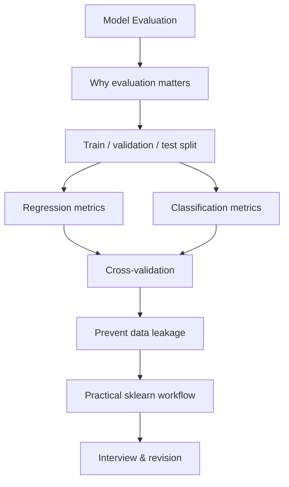

# Model Evaluation

**Day 6**

> Evaluate regression and classification models with the right metrics, understand what each metric measures, and validate performance without data leakage.

---

## Learning Flow



## 1. Overview: Why Model Evaluation Matters

A model that performs well on training data may perform poorly on unseen data. Model evaluation estimates how well a trained model is likely to generalize to new examples.

Evaluation helps us:
- Compare candidate models using consistent criteria.
- Detect overfitting and underfitting.
- Select suitable model settings and decision thresholds.
- Understand the types of errors a model makes.
- Estimate performance on unseen data.

**Core distinction:** training fits model parameters; validation supports model selection; testing gives a final, unbiased estimate after decisions are complete.

## 2. Dataset Splitting: Train, Validation, and Test

### 2.1 Training set

The training set is used to fit model parameters. The model learns patterns from its features and target values.

### 2.2 Validation set

The validation set is used during model development to compare models, tune hyperparameters, select features, and choose thresholds. It is not used to fit the model's learned parameters.

### 2.3 Test set

The test set is held aside until the end. Use it for the final performance estimate after model and hyperparameter decisions are complete. Repeatedly checking test performance turns the test set into an informal validation set.

### 2.4 Typical split

A common starting point is 70% training, 15% validation, and 15% testing, but the correct split depends on dataset size, task, and data collection process.

```python
from sklearn.model_selection import train_test_split

X_train, X_temp, y_train, y_temp = train_test_split(
    X, y, test_size=0.30, random_state=42
)

X_val, X_test, y_val, y_test = train_test_split(
    X_temp, y_temp, test_size=0.50, random_state=42
)
```

For classification, use stratification when appropriate so class proportions are represented in each split:

```python
X_train, X_temp, y_train, y_temp = train_test_split(
    X, y, test_size=0.30, random_state=42, stratify=y
)
```

### 2.5 Important splitting rules

- Split before fitting preprocessing steps that learn from data.
- Fit scalers, imputers, encoders, and feature selectors on training data only.
- Apply the fitted transformations to validation and test data.
- For time-series data, preserve chronological order; random splitting can leak future information into the past.
- For repeated observations from the same person, device, or entity, consider group-based splitting so related records do not cross partitions.

## 3. Regression Evaluation Metrics

Regression predicts continuous numerical values. Metrics compare actual values \(y_i\) with predictions \(\hat{y}_i\).

Let \(n\) be the number of observations and \(e_i = y_i - \hat{y}_i\) be the residual.

### 3.1 Mean Absolute Error (MAE)

\[
MAE = \frac{1}{n}\sum_{i=1}^{n}|y_i-\hat{y}_i|
\]

- Average absolute prediction error.
- Uses the same unit as the target.
- Treats errors linearly; a 10-unit error contributes twice as much as a 5-unit error.
- Less sensitive to large outliers than MSE/RMSE.

**Interpretation:** If MAE is 4.2 when predicting house prices in thousands, the average absolute error is 4.2 thousand units.

### 3.2 Mean Squared Error (MSE)

\[
MSE = \frac{1}{n}\sum_{i=1}^{n}(y_i-\hat{y}_i)^2
\]

- Squares each error before averaging.
- Penalizes large errors more strongly.
- Has squared target units, so it is less directly interpretable.

### 3.3 Root Mean Squared Error (RMSE)

\[
RMSE = \sqrt{\frac{1}{n}\sum_{i=1}^{n}(y_i-\hat{y}_i)^2}
\]

- Square root of MSE.
- Expressed in the same unit as the target.
- More sensitive to large errors than MAE.
- Useful when large mistakes should receive a stronger penalty.

### 3.4 R-squared (R²)

\[
R^2 = 1-\frac{\sum_i(y_i-\hat{y}_i)^2}{\sum_i(y_i-\bar{y})^2}
\]

- Compares the model's squared prediction errors with the baseline that predicts the target mean.
- \(R^2=1\): perfect predictions on the evaluated data.
- \(R^2=0\): no better, in squared-error terms, than predicting the mean.
- \(R^2<0\): worse than that mean-prediction baseline.
- It is not a percentage of predictions that are correct.

### 3.5 Comparing regression metrics

| Metric | Error treatment | Same unit as target? | Outlier sensitivity |
|---|---|---:|---|
| MAE | Absolute error | Yes | Lower than MSE/RMSE |
| MSE | Squared error | No | High |
| RMSE | Square-root of mean squared error | Yes | High |
| R² | Relative squared-error comparison | No | Sensitive to large residuals |

**Metric selection:** Use MAE when typical absolute error is important; RMSE when large errors should be penalized more; R² as a complementary comparison against a mean baseline. Do not select a model from R² alone.

## 4. Classification Evaluation Metrics

Classification predicts discrete classes. For binary classification, each prediction can be compared with the actual label.

### 4.1 Confusion matrix

The confusion matrix counts four outcomes:

| | Predicted positive | Predicted negative |
|---|---:|---:|
| Actual positive | True Positive (TP) | False Negative (FN) |
| Actual negative | False Positive (FP) | True Negative (TN) |

- **TP:** positive case correctly predicted positive.
- **TN:** negative case correctly predicted negative.
- **FP:** negative case incorrectly predicted positive (false alarm).
- **FN:** positive case incorrectly predicted negative (miss).

The cost of FP and FN depends on the application. In disease screening, missing a real case may be especially costly; in spam filtering, incorrectly hiding an important email may be costly.

### 4.2 Accuracy

\[
Accuracy = \frac{TP+TN}{TP+TN+FP+FN}
\]

The fraction of all predictions that are correct.

Accuracy can be misleading with imbalanced classes. If 99% of examples are negative, a model that always predicts negative achieves 99% accuracy while detecting no positives.

### 4.3 Precision

\[
Precision = \frac{TP}{TP+FP}
\]

Of all cases predicted positive, what fraction were actually positive?

High precision means fewer false positives. It matters when false alarms are costly.

### 4.4 Recall (Sensitivity)

\[
Recall = \frac{TP}{TP+FN}
\]

Of all actual positive cases, what fraction did the model identify?

High recall means fewer false negatives. It matters when missing positive cases is costly.

### 4.5 F1-score

\[
F1 = 2\cdot\frac{Precision\cdot Recall}{Precision+Recall}
\]

The harmonic mean of precision and recall. F1 is useful when both matter and a single summary is needed. It does not include true negatives and does not replace examining the confusion matrix.

### 4.6 ROC curve and ROC-AUC

A classifier often outputs a score or probability. Changing the decision threshold changes the predicted labels and therefore the false-positive and true-positive rates.

\[
TPR = \frac{TP}{TP+FN}
\qquad
FPR = \frac{FP}{FP+TN}
\]

- The ROC curve plots TPR against FPR across classification thresholds.
- AUC is the area under that curve.
- ROC-AUC measures how well the model ranks positive examples above negative examples across thresholds.
- AUC near 1 indicates strong ranking; around 0.5 indicates ranking close to random.
- ROC-AUC does not tell you which threshold to deploy.
- With severe class imbalance, also inspect precision-recall behaviour and the cost of errors.

### 4.7 Classification metric selection

| Situation | Metrics to inspect |
|---|---|
| Classes are reasonably balanced and error costs similar | Accuracy, confusion matrix |
| False positives are costly | Precision |
| False negatives are costly | Recall |
| Precision and recall both matter | F1, precision-recall curve |
| Comparing ranking across thresholds | ROC-AUC |
| Strong class imbalance | Precision, recall, F1, confusion matrix; consider PR-AUC |

## 5. Decision Thresholds Change Classification Results

A model may return a probability such as 0.72. With a threshold of 0.50, it is classified as positive; with a threshold of 0.80, it is classified as negative.

- Lowering the threshold usually increases positive predictions, often increasing recall while reducing precision.
- Raising the threshold usually reduces positive predictions, often increasing precision while reducing recall.
- Choose a threshold using validation data and the real cost of FP/FN.
- Do not tune the threshold on the test set.

## 6. K-Fold Cross-Validation

A single train/validation split can produce a result that depends heavily on which examples happened to be selected. K-fold cross-validation provides a more stable estimate by repeating training and validation across different partitions.

### 6.1 How K-fold works

1. Divide the training data into \(K\) approximately equal folds.
2. Train on \(K-1\) folds.
3. Validate on the remaining fold.
4. Repeat until every fold has served as the validation fold once.
5. Aggregate the \(K\) validation scores, commonly by taking their mean and examining their spread.

For 5-fold CV, the model is trained five times; each run uses four folds for training and one for validation.

### 6.2 Choosing K

- 5-fold and 10-fold are common choices.
- Larger K means each training run uses more data, but requires more model fits.
- Smaller datasets may benefit from cross-validation.
- For classification, use stratified folds when class proportions should be preserved.
- For grouped or time-dependent data, use group-aware or time-series-aware validation rather than ordinary random K-fold.

### 6.3 Scikit-learn example

```python
from sklearn.model_selection import cross_val_score, StratifiedKFold
from sklearn.linear_model import LogisticRegression

cv = StratifiedKFold(n_splits=5, shuffle=True, random_state=42)

scores = cross_val_score(
    LogisticRegression(max_iter=1000),
    X_train,
    y_train,
    cv=cv,
    scoring="f1"
)

print("Fold scores:", scores)
print("Mean F1:", scores.mean())
print("Standard deviation:", scores.std())
```

Cross-validation is generally performed on the training portion during model development. Keep the final test set untouched for the final evaluation.

## 7. Avoiding Data Leakage

Data leakage occurs when information unavailable at real prediction time influences model training or evaluation. It can make validation scores look unrealistically good.

Common causes:
- Scaling or imputing the full dataset before splitting.
- Selecting features using the full dataset, including test labels.
- Using future information to predict an earlier event.
- Allowing records from the same entity into both training and validation when that creates dependence.
- Repeatedly tuning decisions against the test set.

Use a scikit-learn Pipeline so preprocessing is fitted separately inside each training fold:

```python
from sklearn.pipeline import make_pipeline
from sklearn.preprocessing import StandardScaler
from sklearn.linear_model import LogisticRegression
from sklearn.model_selection import cross_val_score, StratifiedKFold

pipeline = make_pipeline(
    StandardScaler(),
    LogisticRegression(max_iter=1000)
)

cv = StratifiedKFold(n_splits=5, shuffle=True, random_state=42)
scores = cross_val_score(
    pipeline, X_train, y_train, cv=cv, scoring="f1"
)
```

## 8. Practical Scikit-Learn Evaluation Workflow

### 8.1 Regression

```python
from sklearn.metrics import (
    mean_absolute_error,
    mean_squared_error,
    r2_score
)
import numpy as np

y_pred = model.predict(X_test)

mae = mean_absolute_error(y_test, y_pred)
mse = mean_squared_error(y_test, y_pred)
rmse = np.sqrt(mse)
r2 = r2_score(y_test, y_pred)

print(f"MAE:  {mae:.3f}")
print(f"MSE:  {mse:.3f}")
print(f"RMSE: {rmse:.3f}")
print(f"R2:   {r2:.3f}")
```

### 8.2 Classification

```python
from sklearn.metrics import (
    accuracy_score,
    precision_score,
    recall_score,
    f1_score,
    roc_auc_score,
    confusion_matrix,
    classification_report
)

y_pred = model.predict(X_test)
y_prob = model.predict_proba(X_test)[:, 1]

print("Confusion matrix:\n", confusion_matrix(y_test, y_pred))
print("Accuracy:", accuracy_score(y_test, y_pred))
print("Precision:", precision_score(y_test, y_pred, zero_division=0))
print("Recall:", recall_score(y_test, y_pred, zero_division=0))
print("F1:", f1_score(y_test, y_pred, zero_division=0))
print("ROC-AUC:", roc_auc_score(y_test, y_prob))
print(classification_report(y_test, y_pred, zero_division=0))
```

Use predicted probabilities or decision scores for ROC-AUC, not only hard class predictions. The example assumes a binary classifier whose positive class is represented by column 1.

## 9. Common Mistakes

- Using accuracy alone on imbalanced datasets.
- Confusing precision with recall.
- Treating a high training score as proof of generalization.
- Using the test set repeatedly during tuning.
- Reporting ROC-AUC from hard labels instead of probability/score outputs.
- Fitting preprocessing on the entire dataset before splitting.
- Applying random K-fold to time-series data.
- Reporting only the mean CV score without considering variability.
- Assuming a single metric captures every business cost.

## 10. Interview Questions and Answers

### Beginner

**Q1. What is the difference between MAE and MSE?**

MAE averages absolute errors, so errors grow linearly. MSE averages squared errors, so large errors receive a stronger penalty. MAE is in target units; MSE is in squared target units.

**Q2. What does an R² score of 0 mean?**

On the evaluated data, the model's squared error is equal to the squared error of the baseline that predicts the mean target value.

**Q3. What is a confusion matrix?**

A table that counts true positives, true negatives, false positives, and false negatives, showing the types of classification outcomes.

**Q4. What is the difference between precision and recall?**

Precision asks how many predicted positives were truly positive. Recall asks how many actual positives were successfully identified.

### Intermediate

**Q5. Why can accuracy be misleading?**

With imbalanced classes, a model can predict only the majority class and still achieve high accuracy while failing to identify the minority class.

**Q6. Why do we need validation data if we already have training and test data?**

Validation data supports model selection and hyperparameter tuning without using the final test set. The test set remains reserved for a final estimate.

**Q7. What does ROC-AUC measure?**

It measures how well a model ranks positive examples above negative examples across possible thresholds. It does not select a deployment threshold.

**Q8. Explain k-fold cross-validation.**

The data is divided into K folds. The model is trained K times, each time validating on a different fold and training on the remaining folds. Scores are then aggregated.

### Advanced

**Q9. Why must scaling happen inside cross-validation folds?**

If scaling is fitted before cross-validation, information from validation folds influences the transformation. A Pipeline ensures the scaler is fitted only on each fold's training data.

**Q10. When would you prefer PR-AUC over ROC-AUC?**

For highly imbalanced binary classification, precision-recall analysis can provide a more informative view of positive-class performance because it focuses on precision and recall.

**Q11. Why can R² be negative?**

The model can perform worse, in squared-error terms, than predicting the mean target value on the evaluated dataset.

**Q12. When is ordinary random K-fold inappropriate?**

When observations have time order or group dependence. Use time-series splits for temporal data and group-aware splits when related observations must stay together.

## 11. Practice Exercises

1. Given actual values `[3, 5, 7]` and predictions `[2, 5, 10]`, calculate MAE, MSE, and RMSE by hand.
2. Given TP=40, TN=50, FP=10, FN=20, calculate accuracy, precision, recall, and F1.
3. Explain why a 99%-accurate model may be useless on a dataset with 99% negative examples.
4. Train a regression model and report MAE, RMSE, and R² on a held-out test set.
5. Train a binary classifier and print its confusion matrix, precision, recall, F1, and ROC-AUC.
6. Compare one validation split with 5-fold cross-validation.
7. Build a Pipeline containing a scaler and classifier, then evaluate it with stratified 5-fold CV.
8. Describe a leakage scenario for a time-series prediction problem and explain how to avoid it.

## 12. Quick Revision Sheet

| Concept | Remember |
|---|---|
| MAE | Average absolute error; interpretable in target units |
| MSE | Squared errors; strongly penalizes large errors |
| RMSE | Square root of MSE; target units |
| R² | Compared with predicting the target mean; can be negative |
| Accuracy | Overall fraction correct |
| Precision | TP / (TP + FP) |
| Recall | TP / (TP + FN) |
| F1 | Harmonic mean of precision and recall |
| ROC-AUC | Ranking quality across thresholds |
| Confusion matrix | TP, TN, FP, FN counts |
| Train set | Fit model parameters |
| Validation set | Tune and select |
| Test set | Final evaluation only |
| K-fold CV | Repeated train/validation folds |
| Data leakage | Evaluation receives information it should not have |

## 13. Key Takeaways

- Choose metrics based on the prediction task, class balance, and cost of different errors.
- For regression, understand MAE, MSE, RMSE, and R² rather than reporting only one score.
- For classification, inspect the confusion matrix alongside precision, recall, F1, and ROC-AUC.
- Use train/validation/test separation correctly.
- Use cross-validation for a more robust development estimate, while preserving the test set.
- Prevent leakage by fitting preprocessing only on training data, preferably inside a Pipeline.

## 14. Recommended Resources

1. [StatQuest: ROC and AUC](https://www.youtube.com/watch?v=4jRBRDbJemM)
2. [StatQuest: Confusion Matrix](https://www.youtube.com/watch?v=Kdsp6soqA7o)
3. [Scikit-learn: Model Evaluation](https://scikit-learn.org/stable/modules/model_evaluation.html)
4. [Krish Naik: Cross Validation](https://www.youtube.com/watch?v=fSytzGwwBVw)
